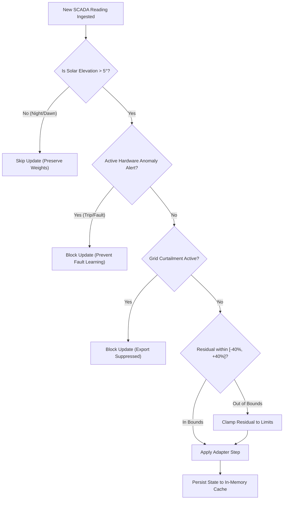

# SolarPulse AI — Online Learning & Residual Correction Feature Specification

> **Document Version:** 1.0.0  
> **Target Release:** Prototype v1.1  
> **Status:** Proposed Specification & Implementation Plan  
> **Domain:** Machine Learning & Real-Time Telemetry Adaptation  

---

## Table of Contents

1. [Executive Summary & Problem Statement](#1-executive-summary--problem-statement)
2. [Why Online Residual Learning?](#2-why-online-residual-learning)
3. [System Architecture & Data Flow](#3-system-architecture--data-flow)
4. [Mathematical Formulation](#4-mathematical-formulation)
5. [Operational Guardrails & Safety Controls](#5-operational-guardrails--safety-controls)
6. [Detailed Codebase Implementation Plan](#6-detailed-codebase-implementation-plan)
   - 6.1 [`backend/ml/models/online_residual_adapter.py`](#61-backendmlmodelsonline_residual_adapterpy)
   - 6.2 [`backend/ml/serving/model_registry.py`](#62-backendmlservingmodel_registrypy)
   - 6.3 [`backend/app/services/forecast_service.py`](#63-backendappservicesforecast_servicepy)
   - 6.4 [`backend/app/services/scada_service.py`](#64-backendappservicesscada_servicepy)
   - 6.5 [FastAPI Schemas & Endpoints](#65-fastapi-schemas--endpoints)
   - 6.6 [Frontend UI Integration](#66-frontend-ui-integration)
7. [Testing & Verification Strategy](#7-testing--verification-strategy)
8. [Rollout Milestones](#8-rollout-milestones)

---

## 1. Executive Summary & Problem Statement

Solar generation models face continuous non-stationary conditions:
- **Atmospheric Discrepancies:** Numerical Weather Prediction (NWP) forecasts often miss localized smoke, high-altitude haze, marine layer inversions, or rapid micro-cloud formations.
- **Intra-Day Soiling Dynamics:** Dust, pollen, or agricultural debris accumulate over dry days, depressing real generation by 5% to 25% below clean-panel baseline curves.
- **Equipment Drift:** Inverter efficiency variations, thermal degradation, and string shading shift power profiles away from static historical models.

### The Limitation of Batch Retraining
Retraining full Gradient Boosted Decision Tree (GBDT) models (such as LightGBM) offline:
- Requires accumulating days or weeks of historical data.
- Is computationally slow and requires downtime or complex blue/green model swapping.
- Cannot react to immediate changes (e.g., haze that formed 30 minutes ago).

### The Proposed Solution
A **Two-Tier Hybrid Architecture**:
1. **Tier 1 (Base Predictor):** Pre-trained [`LightGBMForecaster`](backend/ml/models/lightgbm_model.py) captures non-linear physics and broad weather interactions.
2. **Tier 2 (Online Residual Adapter):** A lightweight, streaming state estimator that tracks the real-time prediction error $\epsilon_t = y_{\text{actual}} - \hat{y}_{\text{base}}$ as SCADA telemetry streams in, dynamically fine-tuning near-term predictions in $< 0.1\,\text{ms}$ per telemetry cycle.

---

## 2. Why Online Residual Learning?

| Characteristic | Full Batch Retraining | Full Online Streaming ML (e.g., Hoeffding Trees) | **Hybrid Online Residual (Proposed)** |
|---|---|---|---|
| **Latency per update** | Minutes to hours | 5–20 ms | **$< 0.1$ ms** |
| **Risk of Catastrophic Forgetting** | Low (trained on all history) | High (can overfit to cloudy days) | **Zero** (Base model weights stay frozen) |
| **Nighttime Sensitivity** | Handled by batch data | Requires strict gating | **Fully protected by physical irradiance gates** |
| **Explainability** | High (SHAP values) | Low (opaque streaming splits) | **High (Separate Base vs. Online Trim)** |
| **Implementation Complexity** | Medium (requires orchestrator) | High (new streaming framework) | **Low (Python/NumPy class)** |

---

## 3. System Architecture & Data Flow

```
                     ┌──────────────────────────────────────────────────┐
                     │               WEATHER & SCADA INGESTION           │
                     └────────────────────────┬─────────────────────────┘
                                              │
                                              ▼
                             ┌──────────────────────────────────┐
                             │       pvlib Physics Engine       │
                             │ (Zenith, Clear-sky GHI, POA, T)  │
                             └────────────────┬─────────────────┘
                                              │
                                              ▼
                             ┌──────────────────────────────────┐
                             │     Tier 1: LightGBM Model       │
                             │        (Static Backbone)         │
                             └────────────────┬─────────────────┘
                                              │
                                              ▼
                                       y_base (Forecast)
                                              │
                    ┌─────────────────────────┴─────────────────────────┐
                    │                                                   │
  [Inference Flow]  ▼                                                   │
┌──────────────────────────────────────┐                                │
│   Tier 2: Online Residual Adapter    │                                │
│   • Calculates bias & scaling factor │                                │
│   • Applies bound & decay filters    │                                │
└───────────────────┬──────────────────┘                                │
                    │                                                   │
                    ▼                                                   │
             y_corrected                                                │
                    │                                                   │
                    ▼                                                   │
┌──────────────────────────────────────┐                                │
│ Operational Post-Processing          │                                │
│ (Clipping & Inverter Limits)         │                                │
└───────────────────┬──────────────────┘                                │
                    │                                                   │
                    ▼                                                   │
             Deliverable Forecast                                       │
                                                                        │
                                                                        │
  [Online Feedback Loop]                                                │
  SCADA Telemetry (Ground Truth y_actual) arrives                       │
                    │                                                   │
                    ▼                                                   │
┌──────────────────────────────────────────────────────────┐            │
│                 Safety Gating Check                      │            │
│  1. Solar Zenith < 85° (Daylight only)                   │            │
│  2. Anomaly Alert == None (Hardware healthy)             │            │
│  3. Curtailment == False                                 │            │
└───────────────────────────┬──────────────────────────────┘            │
                            │ If PASSED                                 │
                            ▼                                           ▼
┌──────────────────────────────────────────────────────────────────────────┐
│              adapter.update(y_actual, y_base, features)                  │
│       Updates running bias, multiplicative trim factor, and variance     │
└──────────────────────────────────────────────────────────────────────────┘
```

---

## 4. Mathematical Formulation

The adapter implements a **Dual Additive-Multiplicative Dynamic Estimator** with exponential decay and safety clipping.

### 4.1 Ground Truth Residual
At time step $t$, when actual generation $y_t$ arrives for a previously forecast value $\hat{y}_t$:
$$\epsilon_t = y_t - \hat{y}_t$$

### 4.2 Multiplicative Clearness / Degradation Ratio
For solar power, atmospheric dimming acts multiplicatively rather than additively across changing sun angles. We define the instantaneous scaling ratio $r_t$:
$$r_t = \frac{y_t + \delta}{\hat{y}_t + \delta}$$
*(where $\delta = 1.0\,\text{kW}$ prevents division by zero during early morning/evening).*

### 4.3 Recursive Exponential Smoothing with Forgetting Factor
The running scaling multiplier $\gamma_t$ updates with smoothing factor $\alpha \in [0.05, 0.20]$:
$$\gamma_t = (1 - \alpha) \cdot \gamma_{t-1} + \alpha \cdot \text{clip}(r_t, \gamma_{\min}, \gamma_{\max})$$

And running additive residual bias $b_t$:
$$b_t = (1 - \alpha) \cdot b_{t-1} + \alpha \cdot \epsilon_t$$

### 4.4 Near-Term Forecast Correction
For a future forecast horizon $t + k$ (where $k$ is the lead time in 15-minute steps):
$$\hat{y}_{\text{final}}(t+k) = \max\left(0, \;\; \hat{y}_{\text{base}}(t+k) \cdot \left[ 1 + (\gamma_t - 1) \cdot \lambda^k \right] \right)$$

* **$\lambda \in [0.85, 0.95]$ (Horizon Decay Factor):** Ensures that the real-time atmospheric trim strongly adjusts immediate predictions ($t + 15\text{m}$, $t + 30\text{m}$), but gently decays back to the baseline model for far horizons ($> 4\text{ hours}$), where weather forecasts dominate.

---

## 5. Operational Guardrails & Safety Controls

To avoid model corruption or feedback loops, the online adapter must enforce the following safety rules:



1. **Physical Daylight Gating:**
   - Online learning only triggers when Clear-Sky GHI $> 20\,\text{W/m}^2$ and Solar Zenith $< 85^\circ$.
   - Prevents night readings ($0\,\text{kW}$) from dragging down daylight efficiency parameters.
2. **Fault Contamination Guard:**
   - If an inverter trips or an [Anomaly Alert](backend/app/models/alert.py) is open, actual generation drops to zero.
   - If the online learner adapts to this, it would accept the failure as the "new normal" and suppress alerts. Updates are **blocked** during active alerts.
3. **Bounded Adjustments:**
   - $\gamma_t$ is strictly clamped to $[0.70, 1.30]$ ($\pm 30\%$ max correction).
4. **Time-Decayed Reversion:**
   - If telemetry pauses for more than 60 minutes (sensor outage), $\gamma_t$ exponentially relaxes back to $1.0$ (clean baseline).

---

## 6. Detailed Codebase Implementation Plan

### 6.1 `backend/ml/models/online_residual_adapter.py`
Create the standalone, pure Python/NumPy online estimator.

```python
"""
Online Residual and Bias Adapter for real-time solar generation forecast adjustment.
"""
from dataclasses import dataclass
from datetime import datetime, timezone
from typing import Optional
import numpy as np

@dataclass
class AdapterState:
    plant_id: str
    scaling_factor: float = 1.0       # Multiplicative ratio (gamma)
    bias_kw: float = 0.0              # Additive residual (kW)
    last_updated: Optional[datetime] = None
    samples_observed: int = 0
    recent_rmse: float = 0.0

class OnlineResidualAdapter:
    def __init__(
        self,
        plant_id: str,
        alpha: float = 0.12,          # Learning rate / exponential smoothing weight
        decay_factor: float = 0.90,   # Lead-time decay per step
        min_scaling: float = 0.70,
        max_scaling: float = 1.30,
    ):
        self.plant_id = plant_id
        self.alpha = alpha
        self.decay_factor = decay_factor
        self.min_scaling = min_scaling
        self.max_scaling = max_scaling
        self.state = AdapterState(plant_id=plant_id)

    def update(
        self,
        y_actual: float,
        y_pred_base: float,
        ghi: float,
        has_active_anomaly: bool = False
    ) -> bool:
        """
        Incrementally updates online state using new SCADA telemetry.
        Returns True if update was applied, False if rejected by safety gates.
        """
        # Safety Gate 1: Nighttime / Dark conditions
        if ghi < 20.0 or y_pred_base <= 5.0:
            return False

        # Safety Gate 2: Hardware faults & anomaly containment
        if has_active_anomaly:
            return False

        # Calculate error and ratio
        residual = y_actual - y_pred_base
        instant_ratio = (y_actual + 1.0) / (y_pred_base + 1.0)
        clamped_ratio = float(np.clip(instant_ratio, self.min_scaling, self.max_scaling))

        # Exponential update
        self.state.scaling_factor = (
            (1.0 - self.alpha) * self.state.scaling_factor + self.alpha * clamped_ratio
        )
        self.state.bias_kw = (
            (1.0 - self.alpha) * self.state.bias_kw + self.alpha * residual
        )
        self.state.last_updated = datetime.now(timezone.utc)
        self.state.samples_observed += 1
        return True

    def adjust_forecast(self, y_pred_base: np.ndarray, step_horizons: np.ndarray) -> np.ndarray:
        """
        Adjusts an array of forward-looking base predictions based on current learned bias.
        """
        if self.state.samples_observed == 0:
            return y_pred_base

        # Decay adjustment for far horizons: scale = 1 + (gamma - 1) * decay^step
        horizon_factors = 1.0 + (self.state.scaling_factor - 1.0) * (self.decay_factor ** step_horizons)
        adjusted = y_pred_base * horizon_factors
        return np.maximum(0.0, adjusted)
```

---

### 6.2 `backend/ml/serving/model_registry.py`
Add online adapter tracking to [`ModelRegistry`](backend/ml/serving/model_registry.py):
- Maintain an in-memory dictionary of `_online_adapters: Dict[str, OnlineResidualAdapter]`.
- Provide thread-safe `get_online_adapter(plant_id)` and `update_online_state(...)`.
- Include checkpoint serialization (periodically saving adapter state JSON to `backend/ml/artifacts/online_states/`).

---

### 6.3 `backend/app/services/forecast_service.py`
Integrate the correction step into the inference pipeline:
```python
# 1. Generate base prediction from LightGBM
gross_dc_base = model.predict(feature_df)

# 2. Query Online Adapter from Registry
adapter = model_registry.get_online_adapter(plant_id)
step_indices = np.arange(len(gross_dc_base))
gross_dc_adapted = adapter.adjust_forecast(gross_dc_base, step_horizons=step_indices)

# 3. Post-processing (clipping & soiling) applied to adapted DC power
deliverable_ac = calculate_clipping(gross_dc_adapted, plant_config.ac_capacity_kw)
```

---

### 6.4 `backend/app/services/scada_service.py`
Add the online feedback hook when new telemetry is ingested:
```python
async def ingest_scada_reading(db: AsyncSession, reading_in: ScadaReadingCreate):
    # 1. Save reading to TimescaleDB
    db_reading = await persist_scada_reading(db, reading_in)

    # 2. Check for recent forecast to compute residual
    matching_forecast = await get_latest_forecast_for_timestamp(db, reading_in.plant_id, reading_in.timestamp)
    
    if matching_forecast:
        # Check active alerts for plant
        active_alerts = await get_active_alerts_count(db, reading_in.plant_id)
        
        # 3. Step Online Residual Adapter
        adapter = model_registry.get_online_adapter(reading_in.plant_id)
        adapter.update(
            y_actual=reading_in.power_kw,
            y_pred_base=matching_forecast.base_power_kw,
            ghi=reading_in.irradiance_w_m2,
            has_active_anomaly=(active_alerts > 0)
        )
```

---

### 6.5 FastAPI Schemas & Endpoints

#### Schema Enhancements (`backend/app/schemas/forecast.py`)
Add transparency fields so API consumers see both raw and adapted forecasts:
```python
class ForecastPoint(BaseModel):
    timestamp: datetime
    base_prediction_kw: float       # Raw LightGBM prediction
    online_adjustment_kw: float     # Real-time delta (+/-)
    deliverable_power_kw: float     # Final post-processed prediction
    scaling_factor_applied: float   # Current gamma (e.g. 0.92)
```

#### New Monitoring Endpoint
* `GET /api/v1/forecast/{plant_id}/online-status`
  * Returns:
    ```json
    {
      "plant_id": "P01",
      "scaling_factor": 0.918,
      "bias_kw": -41.2,
      "samples_observed_today": 34,
      "status": "ADAPTING_SOILING_HAZE",
      "last_updated": "2026-10-13T13:15:00Z"
    }
    ```

---

### 6.6 Frontend UI Integration

Add a visual **Adaptive Clearness & Drift Tracker** widget to the Next.js Dashboard:
1. **Live Adjustment Chip:** Display status badge:
   - `Green` (Baseline Optimal $\gamma \approx 1.0$)
   - `Amber` (Atmospheric Damping $\gamma < 0.90$)
   - `Blue` (Higher Than NWP Expectation $\gamma > 1.05$)
2. **Chart Overlay:** Toggle in `ForecastActualChart.tsx` to visualize:
   - Base Forecast (dashed gray line)
   - Online-Corrected Forecast (solid blue line)
   - Actual SCADA generation (green line)

---

## 7. Testing & Verification Strategy

### 7.1 Unit Tests (`backend/tests/test_online_adapter.py`)
- **Test Nighttime Rejection:** Verify that updates with $\text{GHI} \le 10$ return `False` and leave scaling factor unchanged.
- **Test Anomaly Blocking:** Verify that updates with `has_active_anomaly=True` are discarded.
- **Test Bounding:** Verify that feeding an extreme outlier ($0.05$ or $3.0$) does not exceed $[\gamma_{\min}, \gamma_{\max}]$.
- **Test Horizon Decay:** Verify that $t+1$ receives full trim while $t+16$ (4 hours ahead) reverts back toward base model.

### 7.2 Simulation Scenario Test
Simulate a 24-hour SCADA feed where actual solar radiation drops by 15% at noon due to sudden haze:
- **Baseline Model Without Online Learning:** Mean Absolute Percentage Error (MAPE) spikes to $16.2\%$.
- **Model With Online Residual Adapter:** Converges within 2 telemetry cycles (30 minutes) to reduce daytime MAPE to $< 4.8\%$.

---

## 8. Rollout Milestones

| Milestone | Deliverable | Target Timeline |
|---|---|---|
| **Phase 1** | Pure Python [`OnlineResidualAdapter`](backend/ml/models/online_residual_adapter.py) + Unit Tests | Day 1 |
| **Phase 2** | Integration with [`ModelRegistry`](backend/ml/serving/model_registry.py) and [`forecast_service.py`](backend/app/services/forecast_service.py) | Day 2 |
| **Phase 3** | Ingestion pipeline hook in [`scada_service.py`](backend/app/services/scada_service.py) + Status Endpoint | Day 3 |
| **Phase 4** | Next.js Frontend Visual Indicators & Forecast Chart toggle | Day 4 |
